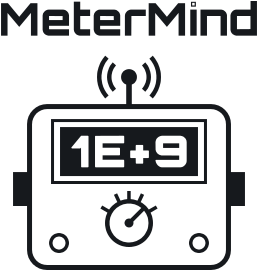

<p align="center">
  <picture>
    <source media="(prefers-color-scheme: dark)" srcset="docs/metermind-dark.svg">
    
  </picture>
</p>

# MeterMind

MeterMind puts a Digcreat XDM1041-DG bench multimeter (a rebadged OWON XDM1041) on your network.
A small ESP32-S3 board plugs into the meter's rear USB port and serves:

- **A dashboard** at `http://metermind.local/` that works like the meter's front panel: the same
  screen, keys, ranges and speeds, live readings, and the jacks the leads should be in.
- **An HTTP/JSON API and a WebSocket stream** ([API.md](API.md)). No client library needed.
- **An MCP server** at `/mcp`, so AI agents can configure the meter and take measurements.
- **Raw SCPI on TCP port 5025** for lab software such as PyVISA.

The meter's USB interface has quirks: set commands are silent, commands sent while it is busy are
dropped, and readings stay stale for a while after a mode change ([PROTOCOL.md](PROTOCOL.md)). The
bridge hides them. Every setting is read back to verify it, and a reading is only returned once it
belongs to the new setting.

## Install the firmware

**From the browser:** open the [web installer](https://jrperson.github.io/MeterMind/) in Chrome or
Edge, connect the board's USB-C port to the computer, press **Install** and pick the board's
serial port. The installer is built from `flasher/` by the release workflow.

**From source** ([ESP-IDF](https://docs.espressif.com/projects/esp-idf/en/v5.5.4/esp32s3/) 5.5.2 or later in the 5.5 series; releases are built with 5.5.4):

```sh
. ~/esp/esp-idf-v5.5/export.sh
cd firmware
idf.py build
idf.py -p /dev/cu.usbserial-XXXX flash monitor   # the board's USB-C port
```

`tools/build_flasher.sh` makes the same release build the installer ships (from
`sdkconfig.defaults` only) and assembles `flasher/` for local testing.

## Connect it to WiFi

On first start the status LED blinks blue and the board opens its own network,
**MeterMind-XXXX**. Join it from a phone or laptop; the setup page opens by itself (or browse to
`http://192.168.4.1/`). Pick your 2.4 GHz network and enter its password. Then rejoin your own
network and open `http://metermind.local/`. Hold BOOT for 3 s to change the network later.
Details, the serial console and the LED colours: [firmware/README.md](firmware/README.md).

## Use it

```sh
curl metermind.local/api/reading
curl -X POST metermind.local/api/measure -d '{"function":"dcv","samples":5}'
curl -X PUT  metermind.local/api/config  -d '{"function":"res","range":5000}'
```

Add it to Claude Code as an MCP server:

```sh
claude mcp add --transport http metermind http://metermind.local/mcp
```

PyVISA: `rm.open_resource("TCPIP::metermind.local::5025::SOCKET", read_termination="\n")`.

### The test leads

The meter cannot sense where the leads are plugged in, so you tell the bridge: tap the jack the
red lead is in on the dashboard, or `PUT /api/leads`. The bridge then refuses a function or range
that does not suit that jack, for example volts with the red lead in a current jack (which blows
the fuse when the leads touch a voltage source). The dashboard can override after asking you; AI
agents cannot, and are told to ask you instead. The setting starts as "not set" after a restart,
and until it is set, current functions are refused. Rules: [API.md](API.md#get-apileads-put-apileads).

## How it works

- **One task owns the meter.** The ESP32-S3 is a USB host to the meter's CH340 serial chip. A
  single task holds the link; every client's request goes through its queue, so requests never
  collide. It polls readings 10 times a second, paces and verifies every set command, and holds
  readings back after a function or range change until the meter has settled (also while it is
  still autoranging).
- **One operation layer for every transport.** REST, WebSocket, MCP and raw SCPI call the same
  operations (`bridge.c`), so they validate and behave the same way.
- **The board** switches the meter's USB power through a current-limited switch: the firmware can
  power-cycle a stuck meter link and reports an overload. It also runs the WiFi setup network,
  mDNS (`metermind.local`, `_metermind._tcp`) and the status LED.
- **A Python prototype** in `bridge/` serves the same API on a computer with the meter connected
  over USB. The firmware is a module-for-module port of it, and the two are kept in step.

| Path | What it is |
|---|---|
| `firmware/` | The ESP32-S3 firmware (ESP-IDF); see [firmware/README.md](firmware/README.md) |
| `bridge/` | The Python prototype; `bridge/static/index.html` is the dashboard both serve |
| `flasher/` | The web installer page (ESP Web Tools) |
| `API.md` | The network API: REST, WebSocket, MCP, SCPI |
| `PROTOCOL.md` | What was learned about the meter's USB and SCPI behaviour |
| `tools/smoke_test.py` | End-to-end test against a real meter |
| `tools/build_flasher.sh` | Release build and installer assembly |

## The board

The firmware runs on the MeterMind board: an ESP32-S3-MINI-1-N8, a USB-A socket that connects to
the meter through a rigid USB-A-male to USB-B-male adapter, meter USB power through a 0.5 A
current-limited switch, USB-C for 5 V power (1 A or more) and a CH340C serial console with
auto-reset, an RGB status LED, and BOOT and RESET buttons. The board's design files are not part
of this repository. The pin map is in `firmware/main/board.h`; other ESP32-S3 boards with a USB
host port should run the firmware after adjusting it (untested).

## Run it without the board

The Python prototype runs on a computer with the meter plugged in over USB:

```sh
python3 -m venv .venv && .venv/bin/pip install -r requirements.txt
.venv/bin/python -m bridge            # finds the meter's CH340; --mdns advertises metermind.local
```

It serves the same dashboard and API at http://localhost:8041 (MCP: `http://localhost:8041/mcp`).

## Tests

- `tools/smoke_test.py [http://metermind.local]`: end-to-end against a real meter, through the
  board or the prototype. **Disconnect the probes first.** It switches functions (including DC
  current on the open input), checks the lead rules, MCP and the raw SCPI port, and restores the
  lead setting afterwards.
- `firmware/tests/run_tests.sh`: host tests for the firmware's parser, checked against the
  prototype's.

## Security

There is no authentication: anyone on your network can drive the meter, change the lead setting
and override it. Requests from web pages on other sites are refused (`Origin` check), which
blocks DNS-rebinding attacks. The WiFi setup network is open unless you set
`CONFIG_BRIDGE_SETUP_PASSWORD`; it only accepts WiFi changes while setup mode is on (BOOT held for
3 s, or no network saved). Run MeterMind on a network you trust.

## Status

- [x] Protocol mapped: queries, set commands, ranges, timing quirks
- [x] Python prototype: REST, WebSocket, MCP, raw SCPI, mDNS, dashboard
- [x] Firmware on the v0.1 board: all transports, WiFi setup with a captive portal, front-panel
      dashboard, lead setting; smoke test passes on the board
- [x] Web installer
- [ ] Firmware updates over WiFi (two OTA slots are reserved; the update code is not written yet)
- [ ] Front-panel features the bridge cannot drive yet: Run/Stop, Math, Record, Dual, Rel, and the
      secondary display

## Licence

Copyright (C) 2026 plasmata

MeterMind is free software: you can redistribute it and/or modify it under the terms of the GNU
General Public License as published by the Free Software Foundation, either version 3 of the
License, or (at your option) any later version. It is distributed in the hope that it will be
useful, but WITHOUT ANY WARRANTY; see [LICENSE](LICENSE) for details.

Built with, under their own licences: ESP-IDF and Espressif's `led_strip`, `mdns`,
`usb_host_cdc_acm` and `usb_host_ch34x_vcp` components (Apache-2.0), cJSON (MIT), ESP Web Tools,
which the installer page loads (Apache-2.0), and for the prototype pyserial (BSD), aiohttp
(Apache-2.0) and zeroconf (LGPL). The logo and credit lettering are drawn with the Orbitron font
(SIL Open Font License 1.1).
