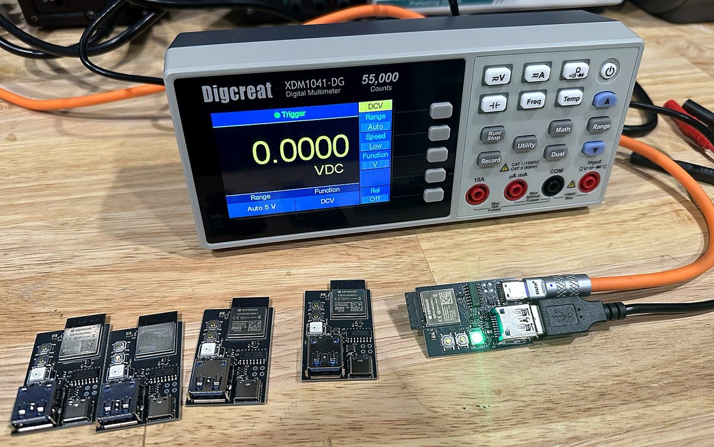

# The MeterMind board

  

Everything you need to order your own MeterMind board, assembled. These are the exact files the
v0.1 boards were made from, and those boards run the firmware in this repository.

| File | What it is |
|---|---|
| [`metermind-v0.1-gerbers.zip`](metermind-v0.1-gerbers.zip) | Gerbers and drill files for the PCB |
| [`metermind-v0.1-bom.csv`](metermind-v0.1-bom.csv) | Bill of materials with LCSC part numbers (JLCPCB format) |
| [`metermind-v0.1-cpl.csv`](metermind-v0.1-cpl.csv) | Placement file (JLCPCB format, rotations already checked) |
| [`metermind-v0.1-schematic.pdf`](metermind-v0.1-schematic.pdf) | The schematic |

## What's on it

- ESP32-S3-MINI-1-N8 module (WiFi, 8 MB flash), with its antenna at the end that overhangs the board
- USB-A socket for the meter, through a 0.5 A current-limited power switch (the firmware can
  power-cycle the meter's USB link and sees an overload)
- USB-C for 5 V power and a CH340C serial console with auto-reset (flashing just works)
- RGB status LED, BOOT and RESET buttons, ESD protection on both USB ports
- 28.5 x 43 mm, 2 layers, 1.6 mm, parts on the top side only

The pin map is in [`firmware/main/board.h`](../firmware/main/board.h).

## Order it from JLCPCB

1. Upload `metermind-v0.1-gerbers.zip` as a new PCB order. JLCPCB reads the size and layer count
   from it; keep **2 layers** and **1.6 mm** thickness. Colour and surface finish are up to you.
2. Turn on **PCB Assembly**, top side only.
3. Upload `metermind-v0.1-bom.csv` and `metermind-v0.1-cpl.csv`. All 19 parts come from JLCPCB's
   own stock. The four test points TP2 to TP5 have no part; leave them unplaced if asked.
4. In the placement preview, check that the pin 1 dot of each chip, the LED and the diode sits on
   the pin 1 mark printed on the board. The placement file has the rotations from the v0.1
   order, but it's worth a look in case JLCPCB's part library has changed since.
5. Order. Parts go in and out of stock; if one is out, pick an equivalent in the same package.

## You'll also need

- A **rigid USB-A male to USB-B male adapter**. The board plugs into the meter's rear USB-B port
  with it.
- A **5 V USB-C supply** (1 A or more) and cable. The meter's USB port is powered from it.

Then install the firmware from the [web installer](https://jrperson.github.io/MeterMind/) and
follow the [setup steps](../README.md#connect-it-to-wifi).

## Notes on v0.1

- WiFi depends a lot on where the board sits. In testing it was noticeably weaker lying flat on
  a desk than hanging free; keep the antenna end away from metal.
- The design is meant for the OWON XDM1041 and tested on the rebadged Digcreat XDM1041-DG.

## Licence

Copyright (C) 2026 plasmata

This source describes Open Hardware and is licensed under the CERN-OHL-S v2 ([LICENSE](LICENSE)).
You may redistribute and modify this source and make products using it under the terms of the
CERN-OHL-S v2. This source is distributed WITHOUT ANY EXPRESS OR IMPLIED WARRANTY, INCLUDING OF
MERCHANTABILITY, SATISFACTORY QUALITY AND FITNESS FOR A PARTICULAR PURPOSE. Please see the
CERN-OHL-S v2 for applicable conditions.

Source location: https://github.com/jrperson/MeterMind. As per CERN-OHL-S v2 section 4, should
you produce hardware based on this source, you must where practicable maintain the source location
visible on the external case or other products you make using this source.
